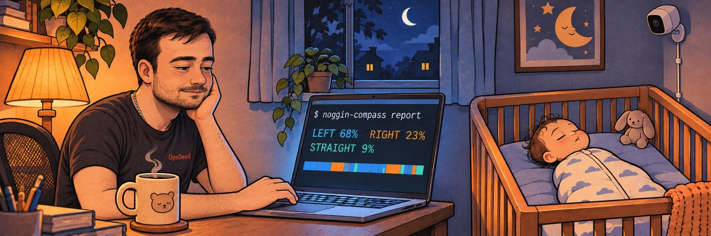
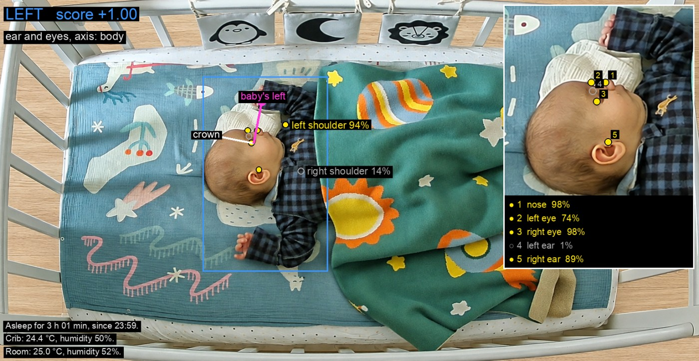
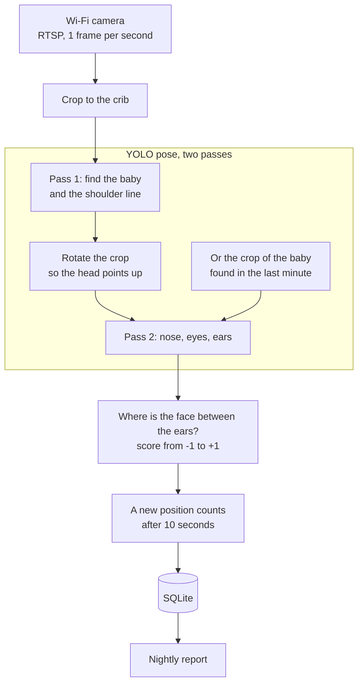

<p align="center">
  
</p>

<h1 align="center">noggin-compass</h1>

<p align="center"><b>Which way does your baby's head point while sleeping, and for how long?</b></p>

<p align="center">
  A small, fully local tool that watches a sleeping baby through an overhead Wi-Fi camera<br>
  and logs how much time the head spends turned <b>left</b>, <b>right</b> or <b>straight</b>.
</p>

<p align="center"><b>English</b> | <a href="README.ru.md">Русский</a></p>

---

## Why

Many babies develop a favourite side to sleep on. If the head almost always rests on the same
spot, that spot can flatten over time (positional plagiocephaly), and a strong preference can
also be a sign of a tight neck muscle (torticollis). Paediatricians usually suggest alternating
the head position, but at 3 a.m. nobody knows how the night actually went.

**noggin-compass** answers that with numbers: *"last night: left 5 h 10 min (68%), right
1 h 45 min (23%), straight 40 min"*, plus a minute-by-minute timeline, so you can see whether
repositioning helps.

> [!IMPORTANT]
> This is a hobby project, **not a medical device and not a baby monitor**. It does not watch
> breathing and raises no safety alarms. If your baby strongly prefers one side, talk to your
> paediatrician.

## What it sees

<p align="center">
  
</p>

The debug view (`--preview`) shows everything the program bases its decision on: the detected
keypoints with their confidence (yellow ones are used, grey ones are too uncertain), the *crown*
and *baby's left* arrows, and a zoomed-in head.

## How it works



* **Keypoints.** An off-the-shelf [Ultralytics YOLO pose](https://docs.ultralytics.com/tasks/pose/)
  model finds 17 body keypoints; we use the nose, eyes, ears and shoulders.
* **Two passes.** Pose models are trained on people who stand or sit. On a baby lying sideways in
  the frame they confidently misplace facial points, ears especially. So the first pass only
  finds the baby and the shoulder line, then the crop is rotated so the head points up and the
  model runs again. On our recording of a sleeping baby with the head in profile this took the
  correct answers from 6 of 28 frames to 27 of 28.
* **Memory.** Seen from above in a white sleep sack, the baby is missed by the first pass on many
  frames even when nothing has changed. So the crop of the last baby found is tried again for a
  minute, and the second pass the model is more sure of wins. If the second pass does not see the
  shoulders, the body axis from the first pass is used. On an evening recording this cut frames
  without an answer from 77 of 229 to 18, and the left/right flips on a baby lying still almost
  disappeared. When the fresh find and the remembered one do not touch, for example a rolled
  bumper next to the head was found instead of the baby, the larger one wins: in a crib that is
  the baby.
* **Empty crib.** To find a baby in a sleep sack, the person threshold has to be low, and then an
  empty crib yields "people" too: a toy on the rail, a strip of the rail at the edge of the frame.
  Next to a baby they are tiny, so anything smaller than `detector.min_person_area` of the frame is
  ignored, see [Configuration](#configuration).
* **Geometry, not magic.** Think of the head as a ball. When it turns, the face moves sideways
  while the ears move towards the middle, so the face position between the ears tells the angle.
  The score is 0 for straight, about 0.35 at 20 degrees and 1 for a full profile; positive means
  the baby's left, negative the right. "Sideways" is measured across the shoulders-to-head line,
  so it does not matter how the baby lies in the crib. Left and right are always **the baby's
  own** left and right.
* **Retroactive tuning.** The raw score of every frame is stored, so changing the threshold or the
  smoothing later re-computes the old nights too.

## Privacy

Everything runs on your own computer:

* the camera stream is read over RTSP inside your home network;
* video is **not recorded**: only numbers go to the database (plus optional snapshots for
  checking accuracy, off by default);
* the camera password stays in an environment variable, your local config or the macOS
  Keychain and never shows up in logs;
* after the model weights are downloaded once, Ultralytics runs in offline mode and its
  telemetry is switched off;
* nothing stops you from blocking the camera's internet access in your router, RTSP keeps
  working locally;
* Telegram is optional: if you turn it on, alert texts and statistics go through Telegram.
  Pictures only go there if you also allow `/photo` with `telegram.photos: true`.

## Hardware

Any Wi-Fi camera with **RTSP** will do. Developed with a **TP-Link Tapo C225** (starlight sensor,
f/1.6 lens, invisible 940 nm infrared, a privacy mode that hides the lens).

Mount the camera **above the crib looking down**: on the ceiling, or high on the wall next to the
crib. Keep the camera and its cable well out of the baby's reach.

## Getting started

You need Python 3.11+ and [uv](https://docs.astral.sh/uv/). Developed and tested on macOS.

```bash
uv sync
```

That is all the installation. The pose model (about 20 MB) is downloaded automatically into
`models/` on the first run; after that the program works without internet. It runs on the CPU by
default, see [CPU or GPU](#cpu-or-gpu) for the Apple or NVIDIA GPU.

The interface is in English; for Russian add `--lang ru` to any command or put `language: ru`
in the config.

**Try it on yourself first.** An overhead camera sees a baby lying on its back the same way a
webcam sees a person sitting in front of it, so the built-in webcam is enough:

```bash
uv run noggin-compass run --preview   # turn your head to your left shoulder: LEFT
uv run noggin-compass report
```

**Connect the camera** (Tapo example):

1. In the Tapo app: *Device settings, Advanced settings, Camera account*. Create a login and a
   password (better without special characters).
2. Copy the example config and put the stream address in, with `{password}` in place of the
   password:
   ```bash
   cp config.example.yaml config.yaml
   ```
   ```yaml
   camera:
     source: rtsp://<login>:{password}@192.168.1.50:554/stream1
     roi: [0.15, 0.25, 0.84, 0.88]   # the crib area, as fractions of the frame
   detector:
     imgsz: 1280                     # the head is small in an overhead view
   ```
3. Give the program the password in any of three ways; it looks for it in this order:
   * a `.env` file next to `config.yaml` (or a real environment variable):
     ```bash
     NOGGIN_CAMERA_PASSWORD=your-camera-password
     ```
   * `camera.password` in `config.yaml`;
   * the macOS Keychain (the command asks for the password and does not echo it):
     ```bash
     security add-generic-password -s noggin-compass-camera -a <login> -w
     ```

   `config.yaml` and `.env` are git-ignored.
4. Run it for the night (`caffeinate` keeps the Mac awake):
   ```bash
   caffeinate -i uv run noggin-compass run
   ```

## Command line

```bash
uv run noggin-compass [--config FILE] [--lang en|ru] run [options]
uv run noggin-compass [--config FILE] [--lang en|ru] report [options]
```

| Option | What it does |
|---|---|
| `-c`, `--config FILE` | Config file to use. Default: `config.yaml` in the current folder; without it the built-in defaults are used. |
| `--lang en\|ru` | Interface language for this run, overrides `language` from the config. |
| **`run`** | Watch the camera (or a video file) and record the head position every second. |
| `--source SOURCE` | Use another video source just this once: an RTSP address, `0` for the webcam or a video file. |
| `--preview` | Open a window with the frame and everything that was detected. Close it with `q`. |
| `--model MODEL` | Use another model just this once, see [Models](#models). |
| `--device DEVICE` | Run the network on `cpu`, `mps` (Apple Silicon GPU) or `0` (first NVIDIA GPU) just this once. |
| `--start TIME` | For a video file: when the recording started, e.g. `2026-11-04T21:30`, so the report gets real times. |
| **`report`** | Print time per side for each day plus a minute-by-minute timeline, then sleep per day. |
| `--days N` | How many recent days to show. Default: 7. |
| `--date DATE` | Show one particular day, e.g. `2026-11-04`. |
| `--timelines N` | For how many of the last days to print details and the timeline. Default: 1. |
| `--chart FILE` | Also save a chart of the last day as a PNG: time per side, a timeline of the head and sleep, left versus right per day. |

A report day runs from noon to noon, so a whole night lands in one day. In the timeline every row
is an hour and every character a minute: `L` left, `R` right, `·` straight, `?` face not visible,
`_` nobody in the crib. The raw score of every frame is stored, so after changing the threshold
or the smoothing the report re-computes old nights too.

## Turn alerts and Telegram

The program can tell you when it is time to turn the baby. Two rules, both off by default:

* **Too long on one side** (`alerts.max_same_side_minutes`): the head has stayed on one side this
  long. A turn to the other side shorter than `alerts.min_turn_minutes` does not count, it does not
  take the pressure off.
* **Imbalance** (`alerts.max_imbalance_minutes`): over the last `alerts.window_hours` one side is
  ahead of the other by this much, and the head is on that side again. This catches patterns like
  "2 h right, half an hour left, 2 h right again", where no single stint is long but the balance is
  off.

```yaml
alerts:
  max_same_side_minutes: 180
  max_imbalance_minutes: 180
```

An alert says which side to turn the head to. It plays a sound and shows a notification on the
computer running the program (macOS) and is repeated every `alerts.repeat_minutes` while the head
stays on that side. The numbers above are an example; agree on the limits with your paediatrician.

**Telegram.** Alerts can also go to Telegram, and the bot answers `/now` (where the head is, whether
it is time to turn and whether the baby is asleep), and over the last 24 hours `/stats` (time per
side), `/sleep` (sleep, see [Sleep](#sleep)) and `/chart` (a chart like `report --chart`). With
`/nap` and `/naps`, parents log sleep the camera cannot see, see [Sleep](#sleep):

1. Create a bot with [@BotFather](https://t.me/BotFather) and store its token in the macOS Keychain
   (the command asks for the token and does not echo it):
   ```bash
   security add-generic-password -s noggin-compass-telegram -a bot -w
   ```
   Or put it into `.env` as `NOGGIN_TELEGRAM_TOKEN=123456:ABC...`.
2. Start the program and send `/start` to your bot. The bot ignores unknown chats and prints their
   id in the log: `ignored a message from chat 123456789`.
3. Allow that chat in `.env` (several ids are separated with commas) and restart the program:
   ```bash
   NOGGIN_TELEGRAM_CHAT_IDS=123456789
   ```

With `telegram.photos: true` the bot also sends a picture from the camera right now: `/photo` as
it is, `/marked` with the detected points, as in the preview. This is off by default, since the
pictures go through Telegram.

The token and chat ids can also go into `config.yaml` (`telegram.token`, `telegram.chat_ids`). The
token is looked up in this order: `NOGGIN_TELEGRAM_TOKEN`, `telegram.token`, the Keychain.

## Sleep

The program also counts how long the baby sleeps in the crib. No extra model is needed: every
second it measures how much of the baby's area changed since the previous frame (the overall
brightness change from a night light or the auto exposure is removed first). A sleeping baby
barely moves, an awake one turns, kicks and waves its arms. This is how sleep actigraphy works.

* Every minute in the crib is *still* or *restless*: restless when at least `sleep.restless_share`
  of its frames had movement.
* The baby is **asleep** after `sleep.fall_asleep_minutes` still minutes in a row, counted from the
  first of them.
* The baby is **awake** after `sleep.wake_minutes` restless minutes within
  `sleep.wake_window_minutes`, or as soon as it is taken out of the crib. Twitches and head turns
  during sleep do not count, even when they go on for a few minutes in a row.

`noggin-compass report` shows sleep per day and the list of sleeps, `/sleep` in Telegram the same
for the last 24 hours, `/now` whether the baby is asleep right now. The raw movement of every frame
is stored, so changed thresholds apply to old nights too.

```
Sleep (days start at 12:00):
04.11 (Wed)  11 h 20 min, sleeps: 4, longest: 4 h 05 min

Sleep on 04.11.2026:
  13:10-14:35  1 h 25 min
  16:00-17:30  1 h 30 min (outside the crib)
  ...
```

**Sleep outside the crib.** The camera does not see naps in arms or in a pram, so parents log them
in Telegram. `/nap` offers buttons with a length, from 15 minutes to 3 hours. The sleep is taken to
have ended when the button is pressed, so press it right after the baby wakes up. `/naps` lists
the latest entries, and each can be changed (a new length, the wake-up time stays) or deleted.
Logged sleep counts in `/sleep`, `/stats`, `/chart` and `report`, marked "outside the crib". A nap
that overlaps sleep the camera saw, or one logged by both parents, is counted once.

Lying still with open eyes also counts as sleep. For a rough daily total this is enough; telling
open eyes from closed would need a face model.

## Configuration

All options with their defaults are in [`config.example.yaml`](config.example.yaml); copy it to
`config.yaml` and keep only what you change.

| Option | Default | What it does |
|---|---|---|
| `language` | `en` | Language of the messages, the report and the preview: `en` or `ru`. |
| **camera** | | |
| `camera.source` | `0` | Where the video comes from: an RTSP address, `0` for the built-in webcam, or a video file. |
| `camera.password` | not set | Camera password, put in place of `{password}` in the address. The `NOGGIN_CAMERA_PASSWORD` environment variable takes precedence; if neither is set, the macOS Keychain entry `noggin-compass-camera` is used. |
| `camera.sample_fps` | `1` | How many frames per second are analysed. The head does not turn often, one is plenty. |
| `camera.rotate` | `0` | Rotates the picture by 90, 180 or 270 degrees before the analysis. |
| `camera.roi` | whole frame | The part of the frame with the crib, as fractions `[left, top, right, bottom]`. Everything outside is ignored, so a parent walking by is not taken for the baby. |
| **detector** | | |
| `detector.model` | `models/yolo11s-pose.pt` | Which neural network finds the keypoints, see [Models](#models). |
| `detector.device` | `cpu` | Where it runs: `cpu`, `mps` (Apple Silicon GPU) or `0` (first NVIDIA GPU), see [CPU or GPU](#cpu-or-gpu). |
| `detector.imgsz` | `640` | How detailed a picture the network gets. In an overhead view the head is small, and 1280 finds the face points much more reliably, at the cost of speed. |
| `detector.upright` | `true` | The second pass on a crop with the baby turned head-up. Switch it off only to save CPU. |
| `detector.min_person_conf` | `0.35` | How sure the network must be that it sees a person at all. Lower it if the baby under a blanket is often "not in frame". |
| `detector.min_person_area` | `0.03` | A "person" smaller than this share of the frame is ignored. With the frame cropped to the crib (`camera.roi`), a newborn takes 10% of it or more, while the toys and strips of the rail that the network took for people in an empty crib took 0.5-2.5% on our camera. Lower it if the baby is small in the frame (a camera mounted high, no `camera.roi`) and the program says "not in frame" while the baby is there. Raise it if the preview still finds people in an empty crib. The real sizes on your camera are in the `box` field of `analysis.jsonl` next to the snapshots, in pixels of the cropped frame. |
| `detector.min_keypoint_conf` | `0.4` | Keypoints with lower confidence are ignored. Raising it makes the program more cautious: more "not visible", fewer mistakes. |
| **head** | | |
| `head.center_threshold` | `0.35` | How far the head has to turn before it counts as left or right instead of straight. 0.35 is about 20 degrees. Raise it if slight turns are counted as left or right, lower it to catch them. |
| `head.mirrored` | `false` | Set to `true` if the camera shows a mirrored picture, otherwise left and right get swapped. |
| `head.fallback_head_direction` | `up` | Where the top of the head points in the frame (`up`, `down`, `left`, `right`) when the shoulders are not visible. Normally the shoulders are found and this is not used. |
| **tracking** | | |
| `tracking.confirm_seconds` | `10` | How long a new head position has to hold before it counts. Filters out single-frame mistakes and brief twitches. |
| `tracking.gap_seconds` | `60` | If no frames arrive for longer (camera or Wi-Fi dropped out), that time is not counted for any side. |
| `tracking.day_starts_at` | `12:00` | When a report day begins. Noon keeps a whole night in one day. |
| **alerts** | | |
| `alerts.max_same_side_minutes` | `0` (off) | Alert when the head has stayed on one side this many minutes, see [Turn alerts](#turn-alerts-and-telegram). |
| `alerts.max_imbalance_minutes` | `0` (off) | Alert when one side is ahead of the other by this many minutes over `alerts.window_hours` and the head is on that side again. |
| `alerts.window_hours` | `12` | How far back the balance between the sides is counted. |
| `alerts.min_turn_minutes` | `10` | A turn to the other side shorter than this does not interrupt a stint on the first side. |
| `alerts.repeat_minutes` | `15` | How often the alert repeats while the head stays on that side. |
| `alerts.sound` | `true` | Play a sound with the alert (macOS). |
| `alerts.sound_file` | `Funk` | Which sound: the name of a macOS system sound (Funk, Glass, Sosumi, Basso...) or a path to a sound file. |
| **telegram** | | |
| `telegram.token` | not set | Bot token from @BotFather. The `NOGGIN_TELEGRAM_TOKEN` environment variable takes precedence; if neither is set, the macOS Keychain entry `noggin-compass-telegram` is used. |
| `telegram.chat_ids` | `[]` | Chats that get alerts and may use the bot commands. The `NOGGIN_TELEGRAM_CHAT_IDS` environment variable (comma-separated) takes precedence. |
| `telegram.photos` | `false` | Allow `/photo` and `/marked`: a picture from the camera, plain or with the detected points. Off by default because the pictures go through Telegram. |
| **sleep** | | |
| `sleep.frame_motion` | `0.02` | A frame counts as movement when this share of the baby's area changed since the previous frame. |
| `sleep.restless_share` | `0.3` | A minute is restless when at least this share of its frames had movement. |
| `sleep.fall_asleep_minutes` | `10` | Asleep after this many still minutes in a row; the sleep starts at the first of them. |
| `sleep.wake_minutes` | `7` | Awake after this many restless minutes... |
| `sleep.wake_window_minutes` | `10` | ...within this many minutes. |
| **storage** | | |
| `storage.db_path` | `data/noggin-compass.db` | SQLite file with the per-second results. |
| `storage.snapshots_dir` | `data/snapshots` | Where snapshots are saved. |
| `storage.snapshot_every_seconds` | `0` (off) | Every N seconds saves the frame, a copy with the detected points and a line in `analysis.jsonl` with all keypoints and the score. Use it to check the accuracy by eye or to recompute statistics later without running the network again. |

## Models

The keypoints come from an [Ultralytics](https://docs.ultralytics.com/tasks/pose/) pose model.
The default is **YOLO11s-pose** (`models/yolo11s-pose.pt`, about 20 MB): small enough to be fast
on a laptop CPU, accurate enough for a baby's face.

Any Ultralytics pose model works. Set it in the config (`detector.model`) or for one run with
`--model`. Models live in the `models/` folder (git-ignored). If the file is not there yet, it is
downloaded automatically on the next run, so switching to another model is just:

```bash
uv run noggin-compass run --preview --model yolo26s-pose.pt
```

The names follow `yolo11{n,s,m,l,x}-pose.pt` and `yolo26{n,s,m,l,x}-pose.pt`: `n` is the fastest
and least accurate, `x` the slowest and most accurate on standard benchmarks. A baby lying across
the frame is not a standard benchmark, though. On 28 hand-labelled frames from our camera:

| Model | Correct | Time per frame (Apple GPU) |
|---|---|---|
| **yolo11s-pose** (default) | **27 of 28** | 59 ms |
| yolo26s-pose | 14 of 28 | 59 ms |
| yolo26l-pose | 16 of 28 | 138 ms |

The newer generation often missed clear head turns or did not find the baby at all, so the
default stays `yolo11s`. You can also point `detector.model` at your own fine-tuned file.

## CPU or GPU

By default the network runs on the **CPU**, which is plenty: the program looks at one frame per
second. Measured on an Apple M4 Pro, two passes at `imgsz: 1280`:

| | CPU | Apple GPU (`mps`) |
|---|---|---|
| yolo11s-pose | 182 ms per frame | 60 ms per frame |
| yolo26s-pose | 215 ms per frame | 67 ms per frame |

The results are identical (keypoints differ by less than a pixel), so `device: mps` on Apple Silicon
simply leaves more CPU free. Trying the remembered crop (see How it works) adds one more pass, about
half as much time again. With an NVIDIA card use `device: 0` (needs a CUDA build of PyTorch).
Nothing else has to be set up.

## Limitations

* A face covered by a hand or a blanket is reported as "not visible" rather than guessed.
* If an adult leans over the crib, the largest person in the crib area is analysed.
* Sleep is told from movement only: lying still with open eyes counts as sleep. Sleep outside the
  crib is only counted when the parents log it in Telegram.

## Roadmap

- [x] Sleep tracking: when the baby fell asleep, woke up, how long each nap was
- [ ] Accuracy check on night-time infrared footage
- [ ] Calibration from a set of labelled snapshots
- [ ] A small local web page with the nightly charts, to check from a phone
- [ ] Running as a background service on an always-on Mac
- [ ] An optional pose model under a permissive license, as an alternative to Ultralytics

## Development

```bash
uv run pytest
```

## License

noggin-compass is free software under the
[GNU Affero General Public License v3.0](LICENSE) (AGPL-3.0), © 2026 Alexander Kirillov.

It is built on [Ultralytics](https://github.com/ultralytics/ultralytics) YOLO, which together
with its pretrained pose models is licensed under AGPL-3.0, so the whole program follows the same
terms. You may use, change and share it. If you pass it on, or let other people use your changed
version over a network, you have to offer them the source code under AGPL-3.0 as well. The
library is installed and the model is downloaded on your machine; neither is part of this
repository. See also the [Ultralytics licensing terms](https://www.ultralytics.com/license).
