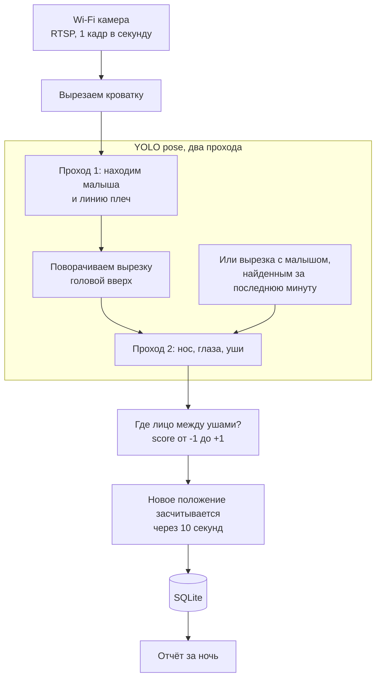

<p align="center">
  
</p>

<h1 align="center">noggin-compass</h1>

<p align="center"><b>Куда малыш поворачивает голову во сне и как долго?</b></p>

<p align="center">
  Небольшая программа, которая полностью локально смотрит на спящего малыша через Wi-Fi камеру<br>
  над кроваткой и считает, сколько времени голова повёрнута <b>влево</b>, <b>вправо</b> или <b>прямо</b>.
</p>

<p align="center"><a href="README.md">English</a> | <b>Русский</b></p>

---

## Зачем

Многие малыши предпочитают спать с головой, повёрнутой в одну сторону. Если голова почти всё
время лежит на одном месте, оно со временем может уплощаться (позиционная плагиоцефалия), а
сильное предпочтение одной стороны бывает признаком кривошеи. Педиатры обычно советуют чередовать
положение головы, но в три часа ночи никто не знает, как на самом деле прошла ночь.

**noggin-compass** отвечает цифрами: *"за ночь: влево 5 ч 10 мин (68%), вправо 1 ч 45 мин (23%),
прямо 40 мин"*, плюс поминутная хронология. Так видно, помогает ли перекладывание.

> [!IMPORTANT]
> Это любительский проект, **не медицинское изделие и не радионяня**. Он не следит за дыханием.
> Его сигналы (пора повернуть, холодно, камера молчит) - помощь, а не гарантия, и каждый можно
> отключить, см. [Как отключить сигналы](#как-отключить-сигналы). Если малыш сильно предпочитает
> одну сторону, покажите его педиатру.

## Что видит программа

<p align="center">
  
</p>

Отладочный режим (`--preview`) показывает всё, на что опирается программа: найденные точки с
уверенностью (жёлтые участвуют в расчёте, серые слишком неуверенные), стрелки "макушка" и
"его лево" и голову крупным планом. В левом нижнем углу: спит ли малыш и показания градусников.
`/marked` в Telegram и `noggin-compass draw` показывают ту же картинку.

## Как это работает



* **Ключевые точки.** Готовая модель [Ultralytics YOLO pose](https://docs.ultralytics.com/tasks/pose/)
  находит 17 точек тела; нам нужны нос, глаза, уши и плечи.
* **Два прохода.** Модели поз учатся на стоящих и сидящих людях. На малыше, который лежит поперёк
  кадра, они уверенно путают точки лица, особенно уши. Поэтому первый проход только находит
  малыша и линию плеч, потом вырезка поворачивается головой вверх, и модель запускается ещё раз.
  На нашей записи спящего малыша с головой в профиль это подняло число верных ответов с 6 из 28
  кадров до 27 из 28.
* **Память.** Сверху в белом спальном мешке первый проход часто не узнаёт малыша, хотя ничего не
  поменялось. Поэтому вырезка с последним найденным малышом проверяется ещё минуту, и побеждает
  тот второй проход, в котором модель увереннее. Если второй проход не видит плеч, ось тела
  берётся из первого. На вечерней записи кадров без ответа стало 18 из 229 вместо 77, а скачки
  право/лево у неподвижно лежащего малыша почти пропали. Если свежая находка и запомненная не
  пересекаются, например вместо малыша нашёлся валик у его головы, побеждает та, что больше: в
  кроватке это малыш.
* **Есть ли малыш в кроватке вообще?** Чтобы находить малыша в спальном мешке, порог уверенности
  модели поз приходится держать низким, и тогда она находит "людей" и в пустой кроватке: в рисунке
  на простыне, в игрушке с мордочкой, в разложенной одежде, в пустом спальном мешке. Поэтому на
  этот вопрос отвечает вторая нейросеть: [SigLIP 2](https://huggingface.co/google/siglip2-base-patch16-224)
  сравнивает всю картинку с короткими описаниями вроде "малыш в кроватке" и "пустая кроватка", и
  обучать её не нужно. Модель поз после этого только говорит, куда повёрнута голова, а если она
  потеряла малыша, который в кроватке (белый спальный мешок ночью), кадр считается "не видно", а
  не "нет в кадре". На полутора сутках снимков минут, когда пустая кроватка выглядела занятой,
  стало 6 вместо 64, минут, когда малыш "пропадал", 8 вместо 29, и выдуманного сна не осталось.
  См. `presence` в [Настройках](#настройки).
* **Геометрия, а не магия.** Представьте голову шаром. При повороте лицо уходит вбок, а уши
  сдвигаются к середине, поэтому по положению лица между ушами виден угол. Score равен 0, когда
  голова прямо, около 0.35 при повороте на 20 градусов и 1 в профиль; плюс означает лево малыша,
  минус право. "Вбок" считается поперёк линии от плеч к голове, поэтому неважно, как малыш лежит
  в кроватке. Лево и право всегда считаются для **самого малыша**.
* **Настройка задним числом.** Для каждого кадра хранится сырой score, так что после смены порога
  или сглаживания старые ночи пересчитываются тоже.

## Приватность

Всё работает на вашем компьютере:

* видео с камеры читается по RTSP внутри домашней сети;
* видео **не записывается**: в базу попадают только числа (и по желанию снимки для проверки
  точности, по умолчанию выключено);
* пароль камеры хранится в переменной окружения, в локальном конфиге или в Связке ключей macOS
  и не попадает в логи;
* после первой загрузки весов обе модели загружаются из `models/` без выхода в интернет,
  телеметрия Ultralytics и Hugging Face отключена;
* камере можно закрыть доступ в интернет в роутере, RTSP внутри квартиры продолжит работать;
* Telegram подключается по желанию: если его включить, тексты сигналов и статистика идут через
  Telegram. Снимки туда уходят, только если отдельно разрешить `/photo` настройкой
  `telegram.photos: true`.
* показания градусников тоже остаются на компьютере. Сами градусники отдают показания любому, кто
  подключится к ним в радиусе Bluetooth, так они устроены.

## Оборудование

Подойдёт любая Wi-Fi камера с поддержкой **RTSP**. Разработано на **TP-Link Tapo C225** (матрица
Starlight, объектив f/1.6, невидимая ИК-подсветка 940 нм, режим приватности, который прячет
объектив).

Повесьте камеру **над кроваткой объективом вниз**: на потолок или высоко на стену рядом с
кроваткой. Камера и провод должны быть далеко от рук малыша.

## Как начать

Нужны Python 3.11+ и [uv](https://docs.astral.sh/uv/). Разработано и проверено на macOS.

```bash
uv sync
```

Это вся установка. Модель поз (около 20 МБ) и модель присутствия (около 1.5 ГБ) скачаются сами в
`models/` при первом запуске, дальше программа работает без интернета. По умолчанию она работает на процессоре, про GPU Apple и NVIDIA
см. [Процессор или видеокарта](#процессор-или-видеокарта).

Интерфейс по умолчанию на английском; для русского добавьте `--lang ru` к любой команде или
пропишите `language: ru` в конфиге.

**Сначала попробуйте на себе.** Камера сверху видит лежащего на спине малыша так же, как
веб-камера видит сидящего перед ней человека, поэтому хватит встроенной камеры Mac:

```bash
uv run noggin-compass --lang ru run --preview   # повернитесь к левому плечу: ВЛЕВО
uv run noggin-compass --lang ru report
```

**Подключите камеру** (на примере Tapo):

1. В приложении Tapo: *Настройки устройства, Дополнительные настройки, Учетная запись камеры*.
   Задайте логин и пароль (лучше без спецсимволов).
2. Скопируйте пример конфига и впишите адрес потока, а вместо пароля напишите `{password}`:
   ```bash
   cp config.example.yaml config.yaml
   ```
   ```yaml
   language: ru
   camera:
     source: rtsp://<логин>:{password}@192.168.1.50:554/stream1
     roi: [0.15, 0.25, 0.84, 0.88]   # область кроватки в долях кадра
   detector:
     imgsz: 1280                     # при виде сверху голова в кадре мелкая
   ```
3. Передайте программе пароль любым из трёх способов; она ищет его в таком порядке:
   * файл `.env` рядом с `config.yaml` (или обычная переменная окружения):
     ```bash
     NOGGIN_CAMERA_PASSWORD=пароль-камеры
     ```
   * `camera.password` в `config.yaml`;
   * Связка ключей macOS (команда сама спросит пароль и не покажет его на экране):
     ```bash
     security add-generic-password -s noggin-compass-camera -a <логин> -w
     ```

   `config.yaml` и `.env` в git не попадают.
4. Запустите на ночь (`caffeinate` не даёт Mac уснуть):
   ```bash
   caffeinate -i uv run noggin-compass run
   ```

## Командная строка

```bash
uv run noggin-compass [--config ФАЙЛ] [--lang en|ru] run [параметры]
uv run noggin-compass [--config ФАЙЛ] [--lang en|ru] report [параметры]
uv run noggin-compass [--config ФАЙЛ] [--lang en|ru] draw СНИМОК... [-o ПАПКА]
uv run noggin-compass [--config ФАЙЛ] [--lang en|ru] thermometer [--seconds N]
```

| Параметр | Что делает |
|---|---|
| `-c`, `--config ФАЙЛ` | Какой файл настроек использовать. По умолчанию `config.yaml` в текущей папке; если его нет, берутся встроенные значения. |
| `--lang en\|ru` | Язык интерфейса на этот запуск, важнее `language` из конфига. |
| **`run`** | Следить за камерой (или видеофайлом) и раз в секунду записывать положение головы. |
| `--source ИСТОЧНИК` | Разово взять другой источник видео: RTSP-адрес, `0` для встроенной камеры или видеофайл. Видеофайл - не сегодняшняя ночь: его кадры пишутся в отдельную базу (`<db_path>-replay.db`), а не к настоящим ночам, и в Telegram ничего не уходит, ничего не звучит, градусники не читаются. |
| `--preview` | Открыть окно с кадром и всем, что нашла программа. Закрывается клавишей `q`. |
| `--model МОДЕЛЬ` | Разово взять другую модель, см. [Модели](#модели). |
| `--device УСТРОЙСТВО` | Разово запустить нейросеть на `cpu`, `mps` (GPU Apple Silicon) или `0` (первая видеокарта NVIDIA). |
| `--start ВРЕМЯ` | Для видеофайла: когда началась запись, например `2026-11-04T21:30`, чтобы в отчёте было настоящее время. |
| **`report`** | Вывести время по сторонам за каждые сутки и поминутную хронологию, затем сон по суткам. |
| `--days N` | За сколько последних суток показать. По умолчанию 7. |
| `--date ДАТА` | Показать одни конкретные сутки, например `2026-11-04`. |
| `--timelines N` | Для скольких последних суток вывести подробности и хронологию. По умолчанию 1. |
| `--chart FILE` | Ещё сохранить график за последние сутки в PNG: время по сторонам, когда голова где была и сон, влево/вправо по суткам. |
| **`draw`** | Нарисовать найденное на сохранённых снимках (см. `storage.snapshot_every_seconds`), как в окне превью. |
| `-o`, `--out ПАПКА` | Куда положить копии с точками. По умолчанию рядом с каждым снимком, как `<имя>_drawn.jpg`. |
| **`thermometer`** | Найти градусники рядом, показать их показания и выбрать, какие читать, см. [Градусник](#градусник). |
| `--seconds N` | Сколько искать градусники. По умолчанию 30. |

Сутки в отчёте обычные, с 00:00 до 24:00. В
хронологии строка соответствует часу, символ минуте: `Л` влево, `П` вправо, `·` прямо, `?` в
кроватке, но лицо не видно, `_` в кроватке никого. Для каждого кадра хранится сырой score, поэтому после смены порога
или сглаживания отчёт пересчитывает и старые ночи.

## Сигналы и Telegram

Программа может подсказать, что пора повернуть малыша. Правил два, по умолчанию оба выключены:

* **Слишком долго на одной стороне** (`alerts.max_same_side_minutes`): голова пролежала на одной
  стороне столько минут. Поворот на другую сторону короче `alerts.min_turn_minutes` не считается:
  давление на затылок за это время не уходит.
* **Перекос** (`alerts.max_imbalance_minutes`): за последние `alerts.window_hours` на одной стороне
  набралось на столько минут больше, чем на другой, и голова снова на ней. Так ловятся случаи вроде
  "2 ч вправо, полчаса влево, снова 2 ч вправо", где ни один заход не длинный, а баланса нет.

```yaml
alerts:
  max_same_side_minutes: 180
  max_imbalance_minutes: 180
```

Сигнал говорит, в какую сторону повернуть голову. На компьютере, где работает программа, звучит
звук и появляется уведомление (macOS); пока голова на той же стороне, сигнал повторяется раз в
`alerts.repeat_minutes`. Числа выше для примера, пороги лучше согласовать с педиатром.

**Telegram.** Сигналы могут приходить и в Telegram, а бот отвечает на `/now` (где сейчас голова, не
пора ли поворачивать и спит ли малыш), а за последние 24 часа `/stats` (время по сторонам), `/sleep`
(сон, см. [Сон](#сон)) и `/chart` (график; кнопки под ним показывают сегодня, вчера или другой день
последней недели, с 00:00 до 24:00). Командами `/nap` и `/naps` родители записывают сон, которого
камера не видит, см. [Сон](#сон). Если камера ничего не присылает `camera.silent_minutes` (5) минут,
бот сообщает об этом, ведь программа тогда не видит кроватку, и сообщает снова, когда камера
заработала; `/now` тоже начинает с этого. Как подключить:

1. Создайте бота через [@BotFather](https://t.me/BotFather) и положите его токен в Связку ключей
   macOS (команда сама спросит токен и не покажет его на экране):
   ```bash
   security add-generic-password -s noggin-compass-telegram -a bot -w
   ```
   Или запишите его в `.env` строкой `NOGGIN_TELEGRAM_TOKEN=123456:ABC...`.
2. Запустите программу и отправьте боту `/start`. Бот не отвечает незнакомым чатам и пишет их номер
   в лог: `сообщение из чата 123456789 пропущено`.
3. Разрешите этот чат в `.env` (несколько номеров через запятую) и перезапустите программу:
   ```bash
   NOGGIN_TELEGRAM_CHAT_IDS=123456789
   ```

С `telegram.photos: true` бот присылает и снимок с камеры прямо сейчас: `/photo` как есть, `/marked`
с найденными точками, как в превью. По умолчанию выключено: снимки идут через Telegram.

Токен и номера чатов можно указать и в `config.yaml` (`telegram.token`, `telegram.chat_ids`). Токен
ищется в таком порядке: `NOGGIN_TELEGRAM_TOKEN`, `telegram.token`, Связка ключей.

### Как отключить сигналы

Любой сигнал можно отключить:

* **Пора повернуть:** выключен, пока `alerts.max_same_side_minutes` и `alerts.max_imbalance_minutes`
  равны 0, так и есть по умолчанию; с `alerts.sound: false` остаются только уведомление и Telegram.
* **Холод:** кнопка **Отключить** под тревогой глушит её на `thermometers.cold.snooze_minutes`.
  На прогулку или пока проветривается комната, `/mute` в Telegram глушит тревогу о холоде на 2 часа
  (`thermometers.cold.mute_hours`; `/mute 3` - на три), так же работает кнопка **Заглушить на 2 ч**
  под сообщением о холоде. `/unmute` включает её снова, а когда время выйдет, она включится сама и,
  если всё ещё холодно, начнёт заново с коротких сигналов. Глушится только тревога о холоде: "пора
  повернуть" и "камера молчит" работают как обычно. `alarm: false` рядом с градусником выключает
  тревогу о холоде для него, а `thermometers.limits.alarm: false` для всех (тогда холод даёт только
  совет).
* **Камера молчит:** `camera.silent_minutes: 0`.
* Советы, пропавший градусник и садящаяся батарейка приходят без звука.

## Сон

Программа ещё считает, сколько малыш спит в кроватке. Отдельная модель для этого не нужна: каждую
секунду она измеряет, какая часть области малыша изменилась с прошлого кадра (общее изменение
яркости от ночника или автоэкспозиции сначала вычитается). Спящий малыш почти не шевелится, а
проснувшийся ворочается, сучит ножками и машет руками. Так работают браслеты для отслеживания сна.

* Каждая минута в кроватке либо *спокойная*, либо *беспокойная*: беспокойная, если движение было
  хотя бы в доле `sleep.restless_share` её кадров.
* Малыш **уснул** после `sleep.fall_asleep_minutes` спокойных минут за
  `sleep.fall_asleep_window_minutes`, считая с первой из них. Не "подряд": засыпая, малыш часто
  машет ручками, хотя глаза уже закрыты.
* Малыш **проснулся** после `sleep.wake_minutes` беспокойных минут за `sleep.wake_window_minutes`
  или сразу, как только его взяли из кроватки. Вздрагивания и повороты головы во сне не в счёт, даже
  если они идут несколько минут подряд.

`noggin-compass report` показывает сон по суткам и список засыпаний, `/sleep` в Telegram то же за
последние 24 часа, `/now` и превью спит ли малыш прямо сейчас. Движение каждого кадра хранится как есть, так
что новые пороги применяются и к прошлым ночам.

```
Сон по суткам:
04.11 (ср)  11 ч 20 мин, засыпаний: 4, самый долгий: 4 ч 05 мин

Сон за 04.11.2026:
  00:00-01:50  1 ч 50 мин (с прошлых суток)
  13:10-14:35  1 ч 25 мин
  16:00-17:30  1 ч 30 мин (вне кроватки)
  ...
```

**Сон вне кроватки.** Сон на руках или в коляске камера не видит, поэтому родители записывают его
в Telegram. `/nap` показывает кнопки с длительностью, от 15 минут до 3 часов. Считается, что сон
закончился в момент нажатия, поэтому нажимать лучше сразу, как малыш проснулся. `/naps` показывает
последние записи, каждую можно изменить (новая длительность, время пробуждения остаётся) или
удалить. Записанный сон учитывается в `/sleep`, `/stats`, `/chart` и `report` с пометкой "вне
кроватки". Если запись пересекается со сном, который видела камера, или её записали оба родителя,
сон считается один раз.

Если малыш спокойно лежит с открытыми глазами, это тоже засчитается как сон. Для общей суммы за
сутки этого хватает; чтобы отличать открытые глаза от закрытых, понадобится модель лица.

## Градусник

Программа может показывать ещё температуру и влажность рядом с малышом, в `/now` и на превью.
Она читает градусники Xiaomi Mijia **LYWSD03MMC** (маленькие квадратные) по Bluetooth, на
заводской прошивке: ни аккаунт Mi Home, ни хаб, ни ключ не нужны.

```bash
uv run noggin-compass thermometer
```

30 секунд ищет градусники рядом и показывает каждый с показаниями:

```
Нашёл рядом: 2
  1. 24.7 °C, влажность 45%, сигнал хороший, батарейка 2.88 В  (id 3C5D)
  2. 24.0 °C, влажность 50%, сигнал хороший, батарейка 2.83 В  (id 6A18)
Чтобы понять, какой где: подержите один в руке минуту и запустите поиск снова, у него поднимется температура.
Какие читать? Номера через пробел, Enter - оставить как есть, 0 - ни одного:
```

Введите номер того, что в кроватке, или несколько номеров: тогда программа спросит название для
каждого, и показания будут подписаны. Выбор записывается в раздел `thermometers` файла
`config.yaml`, остальное в файле не меняется (кроме комментариев внутри списка `devices`). Чтобы
градусники начали читаться, перезапустите `noggin-compass run`.

* **Как читаются показания.** Сам градусник рассылает показания в эфир зашифрованными ключом от
  аккаунта Xiaomi, а тому, кто к нему подключится, отдаёт их открытым текстом. Поэтому раз в
  `thermometers.every_minutes` программа подключается секунд на 10, берёт одно показание и
  отключается. Если оставаться подключённым, быстро сядет батарейка, а телефон с Mi Home не сможет
  подключиться. Все выбранные градусники ищутся одним поиском, и каждый читается, как только
  нашёлся, так что градусник со слабым сигналом не задерживает остальные. Меню сохраняет
  показания, которые сняло, поэтому они видны сразу после перезапуска.
* **Что видно.** В конце `/now` появляется строка вроде "Температура 24.0 °C, влажность 50%,
  батарейка 71%.", а с несколькими градусниками по строке на каждый, с названием. Заряд в
  процентах примерный, по напряжению: батарейка-таблетка почти всю жизнь держит около 2.9 В, а
  потом быстро садится. Если показанию больше двух опросов, рядом написано, сколько ему. На превью
  те же строки, только без батарейки. Каждое показание ещё пишется в лог и в базу (таблица
  `climate`).
* **Bluetooth на Mac.** В первый раз macOS спросит, можно ли терминалу пользоваться Bluetooth:
  разрешите. Программу, запущенную без такого разрешения, macOS останавливает, поэтому запускайте
  её из терминала. Компьютер должен быть в радиусе Bluetooth от каждого градусника, это примерно
  10 м через стену.
* **Адрес.** На Mac у Bluetooth-устройства нет постоянного MAC-адреса: каждый Mac выдаёт ему свой
  идентификатор. Поэтому адрес берётся из `noggin-compass thermometer`, а не с наклейки, и на
  другом компьютере градусники надо выбрать заново.
* Если градусник не отвечает (далеко, занят телефоном), в логе об этом будет одна строка, а
  программа попробует снова при следующем опросе. Камера в любом случае работает дальше.

### Тревога при холоде

На случай, если ночью остались открыты окно или дверь. Правило одно - порог: ниже
`thermometers.limits.cold_below` (18 °C) холодно, 18 °C и выше - нет. Когда градусник показывает
меньше порога:

1. Компьютер, на котором работает программа, каждые 10 секунд подаёт четыре коротких сигнала (`quiet_every_seconds`), а в
   Telegram приходит одно
   сообщение: "кроватка: 17.8 °C, холоднее 18 °C. Проверьте окна и дверь. Проверю снова через 10 мин:
   если будет всё ещё ниже 18 °C, включу тревогу." С этого момента градусники читаются каждые 2 минуты.
2. Решает первое показание, снятое через 10 минут или позже: если всё ещё ниже 18 °C, включается
   тревога: сирена без перерыва (нарастающий вой и те же четыре сигнала, чтобы разбудить),
   уведомление на компьютере и сообщение в Telegram с кнопкой **Отключить** каждую минуту.
   Решение ждёт это новое показание, поэтому может прийти на пару минут позже 10 (следующее чтение
   плюс поиск по Bluetooth). Если градусник перестал отвечать, тревоги нет; через `lost_minutes`
   Telegram сообщит, что он пропал.
3. **Отключить** глушит тревогу на 20 минут. Если первое показание после этого всё ещё ниже 18 °C,
   она включается снова.
   **Заглушить на 2 ч** глушит её надольше, см. [Как отключить сигналы](#как-отключить-сигналы).
4. Показание 18 °C и выше заканчивает всё на любом этапе, и Telegram сообщает об этом без звука.
   Если снова станет ниже, всё начинается с шага 1.

`/now` показывает, что сейчас с тревогой. Сигнал и сирену программа делает сама, на полной
громкости; они играют на компьютере с его громкостью, которую программа не трогает, так что на ночь
не убавляйте её. Время и звуки настраиваются в `thermometers.cold`.

### Советы, пропавший градусник, батарейка

Ещё Telegram без звука сообщает:

* когда становится теплее `hot_above` (22 °C), суше `dry_below` (40%) или влажнее `humid_above`
  (60%), с советом, что сделать. Совет приходит, когда началось, а такой же повторно не раньше чем
  через `thermometers.tips_every_hours`. Пока не прошло, его видно и в `/now`;
* когда градусник не отвечает дольше `thermometers.lost_minutes`, и когда снова ответил;
* когда батарейка опускается ниже `thermometers.low_battery_volts`, раз в сутки. В нём CR2032. По
  отзывам её хватает на 8-12 месяцев; опрос раз в 10 минут отнимает часть этого срока, так что
  держите запасную.

### Пороги для каждого градусника

Пороги по умолчанию в `thermometers.limits` взяты из обычных советов педиатров для сна малыша:
18-22 °C и влажность 40-60%. У любого градусника могут быть свои, с теми же названиями, рядом с его
адресом в `config.yaml`:

```yaml
thermometers:
  devices:
    - address: "5E1A7C30-9B2D-4F86-A1C4-3D7E9F2B6A18"
      name: "кроватка"
      cold_below: 20       # тревога уже ниже 20 °C
    - address: "C9047B2E-61D3-4A5F-8E2B-07F4D1A93C5D"
      name: "коридор"
      alarm: false         # холод здесь даёт совет, без тревоги
```

Меню сохраняет их, когда выбор меняется. После правки перезапустите `noggin-compass run`.

## Настройки

Все параметры со значениями по умолчанию лежат в [`config.example.yaml`](config.example.yaml);
скопируйте его в `config.yaml` и оставьте только то, что меняете. Значение не того вида (число в
кавычках, `yes` вместо числа, кроватка за пределами кадра) останавливает программу сразу при
запуске, с названием параметра, а не ночью, когда параметр впервые понадобится.

| Параметр | По умолчанию | Что делает |
|---|---|---|
| `language` | `en` | Язык сообщений, отчёта и превью: `en` или `ru`. |
| **camera** | | |
| `camera.source` | `0` | Откуда брать видео: RTSP-адрес, `0` для встроенной камеры или видеофайл. |
| `camera.silent_minutes` | `5` | Если камера столько минут ничего не присылает, Telegram сообщает об этом, и снова, когда она заработала. 0 выключает. |
| `camera.password` | не задан | Пароль камеры, подставляется вместо `{password}` в адресе. Переменная окружения `NOGGIN_CAMERA_PASSWORD` важнее; если не задано ни то, ни другое, берётся запись `noggin-compass-camera` из Связки ключей macOS. |
| `camera.sample_fps` | `1` | Сколько кадров в секунду анализировать. Голова поворачивается нечасто, одного хватает. |
| `camera.rotate` | `0` | Поворачивает картинку на 90, 180 или 270 градусов перед анализом. |
| `camera.roi` | весь кадр | Часть кадра с кроваткой в долях `[слева, сверху, справа, снизу]`. Всё вокруг не анализируется, поэтому проходящий мимо взрослый не будет принят за малыша. |
| **detector** | | |
| `detector.model` | `models/yolo11s-pose.pt` | Какая нейросеть ищет точки, см. [Модели](#модели). |
| `detector.device` | `cpu` | Где она работает: `cpu`, `mps` (GPU Apple Silicon) или `0` (первая видеокарта NVIDIA), см. [Процессор или видеокарта](#процессор-или-видеокарта). |
| `detector.imgsz` | `640` | Насколько подробную картинку получает нейросеть. При виде сверху голова мелкая, и с 1280 точки лица находятся заметно надёжнее, но медленнее. |
| `detector.upright` | `true` | Второй проход по вырезке с малышом, повёрнутым головой вверх. Выключать стоит только ради экономии процессора. |
| `detector.min_person_conf` | `0.35` | Насколько нейросеть поз должна быть уверена, что видит человека. Уменьшите, если малыш под одеялом часто оказывается "не видно". |
| `detector.min_person_area` | `0.06` | "Человек" меньше этой доли кадра не учитывается. Если кадр обрезан до кроватки (`camera.roi`), малыш занимает от 10% кадра, а игрушки, бортик и рисунок на простыне, которые нейросеть принимала за людей в пустой кроватке, на нашей камере занимали от 1 до 6%. Уменьшите, если малыш в кадре мелкий (камера высоко, нет `camera.roi`) и часто оказывается "не видно", хотя он в кроватке. С `presence.enabled: false` увеличьте, если в пустой кроватке превью всё ещё находит людей; с включённой проверкой присутствия пустую кроватку, которая выходит занятой, правит `presence.threshold`. Настоящие размеры на вашей камере видны в поле `box` файла `analysis.jsonl` рядом со снимками, в пикселях обрезанного кадра. |
| `detector.min_keypoint_conf` | `0.4` | Точки с меньшей уверенностью не учитываются. Если увеличить, программа станет осторожнее: больше "не видно", меньше ошибок. |
| `presence.enabled` | `true` | Вторая нейросеть решает, есть ли малыш в кроватке вообще (см. Как это работает). Без неё решает модель поз, и пустая кроватка с рисунком на простыне, игрушками или одеждой может давать "не видно", повороты головы и даже сон. Если модель не загрузилась (нет интернета при первом скачивании, не хватает памяти) или сломалась во время работы, программа продолжает на одной модели поз, как с `false`, и пишет об этом в лог. Если модель не загрузилась, так будет до перезапуска, а если сломалась во время работы, то до первой удачной проверки. |
| `presence.model` | `google/siglip2-base-patch16-224` | Модель SigLIP или SigLIP 2 с Hugging Face с фиксированным размером картинки (модели NaFlex не подойдут). Модель по умолчанию весит около 1.5 ГБ, одна проверка на процессоре Apple M4 Pro занимает 40-60 мс. |
| `presence.threshold` | `0.35` | Насколько нейросеть должна быть уверена (0..1), что малыш в кроватке. На нашей камере малыш получал 0.6-1.0, а пустая кроватка 0-0.13, что бы в ней ни лежало, так что точное значение мало на что влияет. Уменьшите, если малыш под одеялом выходит "нет в кадре". Увеличьте, если пустая кроватка выходит занятой. Оценка каждого снимка лежит в поле `presence` файла `analysis.jsonl`. В отличие от порогов поворота головы, новое значение действует только с этого момента. |
| `presence.every_seconds` | `5` | Как часто проверять. В промежутках действует последний ответ, так что малыша положили или забрали, программа увидит не позже чем через столько секунд. |
| **head** | | |
| `head.center_threshold` | `0.35` | Насколько сильно нужно повернуть голову, чтобы это считалось поворотом влево или вправо, а не "прямо". 0.35 примерно 20 градусов. Увеличьте, если лёгкие повороты попадают во "влево" и "вправо", уменьшите, чтобы их ловить. |
| `head.mirrored` | `false` | Включите, если камера показывает зеркальную картинку, иначе лево и право перепутаются. |
| `head.fallback_head_direction` | `up` | Куда в кадре смотрит макушка (`up`, `down`, `left`, `right`), если плечи не видны. Обычно плечи находятся, и этот параметр не используется. |
| **tracking** | | |
| `tracking.confirm_seconds` | `10` | Сколько должно продержаться новое положение головы, чтобы его засчитать. Отсекает ошибки на отдельных кадрах и короткие подёргивания. |
| `tracking.gap_seconds` | `60` | Если кадров нет дольше (отвалилась камера или Wi-Fi), это время не засчитывается ни одной стороне. |
| `tracking.day_starts_at` | `00:00` | Когда начинаются сутки в отчёте: по умолчанию обычные сутки. Сон через полночь даёт каждым суткам их часы, а засыпание считается один раз, в тех сутках, когда малыш заснул; в строках это подписано. |
| **alerts** | | |
| `alerts.max_same_side_minutes` | `0` (выкл.) | Сигнал, когда голова пролежала на одной стороне столько минут, см. [Сигналы](#сигналы-и-telegram). |
| `alerts.max_imbalance_minutes` | `0` (выкл.) | Сигнал, когда за `alerts.window_hours` на одной стороне набралось на столько минут больше, чем на другой, и голова снова на ней. |
| `alerts.window_hours` | `12` | За сколько последних часов считается баланс сторон. |
| `alerts.min_turn_minutes` | `10` | Поворот на другую сторону короче этого не прерывает заход на первую. |
| `alerts.repeat_minutes` | `15` | Как часто повторять сигнал, пока голова на той же стороне. |
| `alerts.sound` | `true` | Звук вместе с сигналом (macOS). |
| `alerts.sound_file` | `Funk` | Какой звук: имя системного звука macOS (Funk, Glass, Sosumi, Basso...) или путь к своему файлу. |
| **telegram** | | |
| `telegram.token` | не задан | Токен бота от @BotFather. Переменная окружения `NOGGIN_TELEGRAM_TOKEN` важнее; если не задано ни то, ни другое, берётся запись `noggin-compass-telegram` из Связки ключей macOS. |
| `telegram.chat_ids` | `[]` | Чаты, которые получают сигналы и могут пользоваться командами бота. Переменная окружения `NOGGIN_TELEGRAM_CHAT_IDS` (через запятую) важнее. |
| `telegram.photos` | `false` | Разрешить `/photo` и `/marked`: снимок с камеры как есть или с найденными точками. По умолчанию выключено, потому что снимки идут через Telegram. |
| **sleep** | | |
| `sleep.frame_motion` | `0.02` | Кадр считается движением, если изменилась такая доля области малыша с прошлого кадра. |
| `sleep.restless_share` | `0.3` | Минута беспокойная, если движение было хотя бы в такой доле её кадров. |
| `sleep.fall_asleep_minutes` | `8` | Уснул после стольких спокойных минут... |
| `sleep.fall_asleep_window_minutes` | `10` | ...за столько минут; сон начинается с первой спокойной. Если поставить оба числа одинаковыми, спокойные минуты понадобятся подряд. |
| `sleep.wake_minutes` | `7` | Проснулся после стольких беспокойных минут... |
| `sleep.wake_window_minutes` | `10` | ...за столько минут. |
| `sleep.out_minutes` | `1` | Малыша считают взятым из кроватки, только если "нет в кадре" столько минут подряд. С включённой проверкой присутствия малыш, которого потеряла нейросеть поз, остаётся "не видно", и сон продолжается, так что менять это незачем. С `presence.enabled: false` днём нейросеть иногда теряет неподвижного малыша в белом спальном мешке на минуту-две, и сон обрывается; с 2-3 такой сон сохранится, но если нейросеть находит "людей" в пустой кроватке (рисунок на простынке, пустой мешок), может насчитаться сон, которого не было. |
| **storage** | | |
| `storage.db_path` | `data/noggin-compass.db` | Файл SQLite с посекундными результатами. |
| `storage.snapshots_dir` | `data/snapshots` | Куда сохраняются снимки. |
| `storage.snapshot_every_seconds` | `0` (выкл.) | Раз в N секунд сохраняет кадр и строку в `analysis.jsonl` со всеми точками и score. Пригодится, чтобы проверить точность глазами, позже пересчитать статистику, не запуская нейросеть заново, или обучить свою модель. Посмотреть, что нашлось на снимке: `uv run noggin-compass draw data/snapshots/2026-11-05/0812*.jpg` рисует точки на копии, как в окне превью. Кадр занимает около 500 КБ, так что раз в 10 с выходит около 4 ГБ в сутки. |
| `thermometers.devices` | `[]` | Какие градусники читать: у каждого `address` и по желанию `name`. Проще всего заполнить командой `noggin-compass thermometer`, см. [Градусник](#градусник). С одним градусником строки в `/now` и на превью идут без названия; сообщения и лог называют его, если название задано. |
| `thermometers.every_minutes` | `10` | Как часто читать градусники. Каждое чтение подключается к градуснику секунд на 10, и батарейку это тратит больше, чем его собственная работа, так что сильно уменьшать не стоит: температура в комнате всё равно меняется медленно. |
| `thermometers.scan_seconds` | `90` | Сколько искать градусник перед каждым чтением. Он сообщает о себе раз в несколько секунд, и при слабом сигнале многое теряется: один из наших нашёлся только через 47 с. Поиск заканчивается, как только градусник найден, так что большое значение ничего не стоит. Увеличьте, если в логе часто пишется, что градусник не найден. |
| `thermometers.low_battery_volts` | `2.5` | Ниже этого напряжения `/now` и Telegram говорят, что батарейка садится. Новая CR2032 даёт около 3.0 В, а градусник перестаёт работать примерно при 2.2 В. |
| `thermometers.lost_minutes` | `30` | Telegram сообщает, что градусник пропал, если он не отвечает столько минут, и сообщает снова, когда он ответил. |
| `thermometers.tips_every_hours` | `3` | Совет про жару или влажность приходит без звука, когда началось, а такой же повторно не раньше чем через столько часов: около порога он иначе приходил бы и уходил каждый опрос. |
| `thermometers.limits.cold_below` | `18` | Ниже этого (°C) включается [тревога при холоде](#тревога-при-холоде). 18 °C - нижняя граница, которую обычно советуют для детской, и минимум для жилья по ВОЗ. У каждого градусника может быть свой, см. [Пороги для каждого градусника](#пороги-для-каждого-градусника), как и остальные пороги. |
| `thermometers.limits.hot_above` | `22` | Выше этого (°C) совет одеть малыша легче или убавить отопление. |
| `thermometers.limits.dry_below` | `40` | Ниже этой влажности (%) совет включить увлажнитель. |
| `thermometers.limits.humid_above` | `60` | Выше этой влажности (%) совет включить осушитель. |
| `thermometers.limits.alarm` | `true` | Включает ли холод тревогу. `false`: только совет, как про жару. |
| `thermometers.cold.check_minutes` | `10` | Сколько минут подавать сигнал перед тревогой: решает первое показание, снятое через это время или позже. |
| `thermometers.cold.repeat_minutes` | `1` | Как часто повторять сообщение о тревоге в Telegram, пока её не отключат. |
| `thermometers.cold.snooze_minutes` | `20` | На сколько минут кнопка **Отключить** глушит тревогу. |
| `thermometers.cold.every_minutes` | `2` | Как часто читать градусники, пока холоднее `cold_below` + `close_degrees`, чтобы тревога следила за температурой. Тратит батарейку, но только в холодные ночи. |
| `thermometers.cold.close_degrees` | `1.0` | См. `every_minutes` выше. |
| `thermometers.cold.mute_hours` | `2` | На сколько часов `/mute` в Telegram и кнопка под сообщением о холоде глушат тревогу о холоде. `/mute 3` глушит на 3 часа, что бы здесь ни стояло. |
| `thermometers.cold.quiet_every_seconds` | `10` | Как часто подавать сигнал перед тревогой. |
| `thermometers.cold.quiet_sound`, `quiet_volume` | `beep`, `1.0` | Звук первой стадии: `beep` (четыре коротких сигнала) или `siren` (нарастающий вой и те же сигналы), свои звуки программы, либо системный звук macOS (Tink, Ping, Sosumi, Funk...) или файл; и его громкость 0..1 от громкости Мака. |
| `thermometers.cold.alarm_sound`, `alarm_volume` | `siren`, `1.0` | Звук тревоги, выбор тот же, играет без перерыва; и его громкость. |

## Модели

Точки находит модель поз от [Ultralytics](https://docs.ultralytics.com/tasks/pose/). По умолчанию
это **YOLO11s-pose** (`models/yolo11s-pose.pt`, около 20 МБ): достаточно маленькая, чтобы быстро
работать на процессоре ноутбука, и достаточно точная для лица малыша.

Подойдёт любая модель поз Ultralytics. Укажите её в конфиге (`detector.model`) или разово через
`--model`. Модели лежат в папке `models/` (в git не попадает). Если файла там ещё нет, он
скачается сам при следующем запуске, так что сменить модель можно одной командой:

```bash
uv run noggin-compass run --preview --model yolo26s-pose.pt
```

Имена устроены так: `yolo11{n,s,m,l,x}-pose.pt` и `yolo26{n,s,m,l,x}-pose.pt`, где `n` самая
быстрая и наименее точная, `x` самая медленная и точная на стандартных тестах. Но малыш, лежащий
поперёк кадра, на стандартный тест не похож. На 28 кадрах с нашей камеры, размеченных вручную:

| Модель | Верно | Время на кадр (GPU Apple) |
|---|---|---|
| **yolo11s-pose** (по умолчанию) | **27 из 28** | 59 мс |
| yolo26s-pose | 14 из 28 | 59 мс |
| yolo26l-pose | 16 из 28 | 138 мс |

Новое поколение часто пропускало явные повороты головы или вообще не находило малыша, поэтому по
умолчанию остаётся `yolo11s`. В `detector.model` можно указать и свою дообученную модель.

## Процессор или видеокарта

По умолчанию нейросеть работает на **процессоре**, и этого хватает: программа смотрит один кадр в
секунду. Замеры на Apple M4 Pro, два прохода при `imgsz: 1280`:

| | Процессор | GPU Apple (`mps`) |
|---|---|---|
| yolo11s-pose | 182 мс на кадр | 60 мс на кадр |
| yolo26s-pose | 215 мс на кадр | 67 мс на кадр |

Результаты одинаковые (точки расходятся меньше чем на пиксель), так что `device: mps` на Apple
Silicon просто оставляет процессор свободнее. Запомненная вырезка (про неё в разделе о том, как это
работает) добавляет ещё один проход, это примерно в полтора раза дольше. С видеокартой NVIDIA
укажите `device: 0` (нужна сборка PyTorch с CUDA). Больше ничего настраивать не нужно.

## Ограничения

* Если лицо закрыто рукой или одеялом, программа пишет "не видно", а не угадывает.
* Если над кроваткой наклоняется взрослый, анализируется самый крупный человек в области кроватки.
* Сон определяется только по движению: спокойное лежание с открытыми глазами считается сном. Сон
  вне кроватки учитывается, только если родители записали его в Telegram.
* Проверка присутствия опробована на полутора сутках с одной кроваткой и одной камерой, малыша в
  инфракрасном свете среди этих снимков ещё не было.

## Разработка

```bash
uv run pytest
```

## Лицензия

noggin-compass - свободная программа под лицензией
[GNU Affero General Public License v3.0](LICENSE) (AGPL-3.0), © 2026 Alexander Kirillov.

Программа построена на [Ultralytics](https://github.com/ultralytics/ultralytics) YOLO, которая
вместе с готовыми моделями поз распространяется под AGPL-3.0, поэтому вся программа следует тем
же условиям. Её можно использовать, менять и передавать другим. Если вы передаёте её дальше или
даёте другим людям пользоваться вашей изменённой версией по сети, им нужно предложить исходный
код тоже под AGPL-3.0. Библиотека устанавливается, а модель скачивается у вас на компьютере; в
этот репозиторий они не входят. См. также
[условия лицензии Ultralytics](https://www.ultralytics.com/license).

Проверка присутствия использует модель SigLIP 2 от Google и библиотеку Hugging Face
Transformers, обе под Apache-2.0. Градусники читаются библиотекой
[Bleak](https://github.com/hbldh/bleak) под лицензией MIT.
