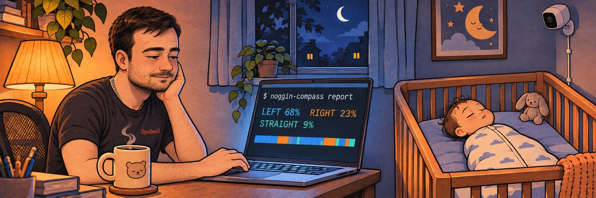
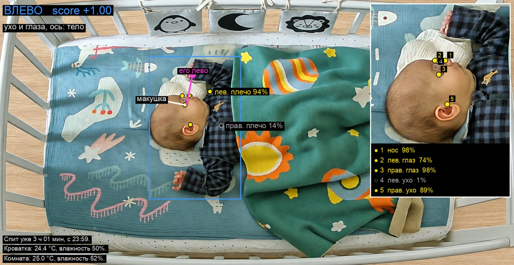
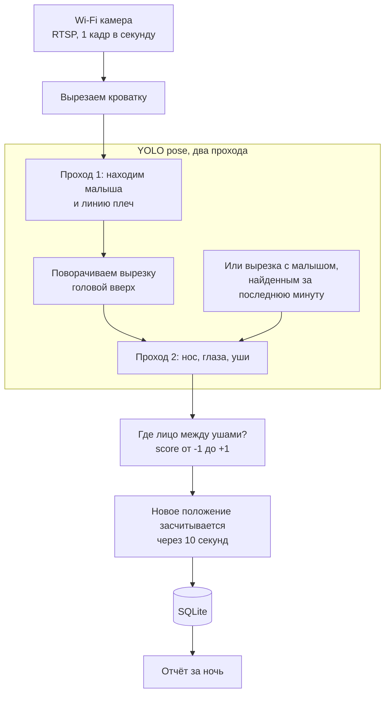

<p align="center">
  
</p>

<h1 align="center">noggin-compass</h1>

<p align="center"><b>Куда малыш поворачивает голову во сне и как долго?</b></p>

<p align="center">
  Небольшая программа, которая полностью локально смотрит на спящего малыша через Wi-Fi камеру<br>
  над кроваткой и считает, сколько времени голова повёрнута <b>влево</b>, <b>вправо</b> или <b>прямо</b>.
</p>

<p align="center"><a href="README.md">English</a> | <b>Русский</b></p>

---

## Зачем

Многие малыши предпочитают спать с головой, повёрнутой в одну сторону. Если голова почти всё
время лежит на одном месте, оно со временем может уплощаться (позиционная плагиоцефалия), а
сильное предпочтение одной стороны бывает признаком кривошеи. Педиатры обычно советуют чередовать
положение головы, но в три часа ночи никто не знает, как на самом деле прошла ночь.

**noggin-compass** отвечает цифрами: *"за ночь: влево 5 ч 10 мин (68%), вправо 1 ч 45 мин (23%),
прямо 40 мин"*, плюс поминутная хронология. Так видно, помогает ли перекладывание.

> [!IMPORTANT]
> Это любительский проект, **не медицинское изделие и не радионяня**. Он не следит за дыханием и
> не поднимает тревогу. Если малыш сильно предпочитает одну сторону, покажите его педиатру.

## Что видит программа

<p align="center">
  
</p>

Отладочный режим (`--preview`) показывает всё, на что опирается программа: найденные точки с
уверенностью (жёлтые участвуют в расчёте, серые слишком неуверенные), стрелки "макушка" и
"его лево" и голову крупным планом.

## Как это работает



* **Ключевые точки.** Готовая модель [Ultralytics YOLO pose](https://docs.ultralytics.com/tasks/pose/)
  находит 17 точек тела; нам нужны нос, глаза, уши и плечи.
* **Два прохода.** Модели поз учатся на стоящих и сидящих людях. На малыше, который лежит поперёк
  кадра, они уверенно путают точки лица, особенно уши. Поэтому первый проход только находит
  малыша и линию плеч, потом вырезка поворачивается головой вверх, и модель запускается ещё раз.
  На нашей записи спящего малыша с головой в профиль это подняло число верных ответов с 6 из 28
  кадров до 27 из 28.
* **Память.** Сверху в белом спальном мешке первый проход часто не узнаёт малыша, хотя ничего не
  поменялось. Поэтому вырезка с последним найденным малышом проверяется ещё минуту, и побеждает
  тот второй проход, в котором модель увереннее. Если второй проход не видит плеч, ось тела
  берётся из первого. На вечерней записи кадров без ответа стало 18 из 229 вместо 77, а скачки
  право/лево у неподвижно лежащего малыша почти пропали. Если свежая находка и запомненная не
  пересекаются, например вместо малыша нашёлся валик у его головы, побеждает та, что больше: в
  кроватке это малыш.
* **Пустая кроватка.** Чтобы находить малыша в спальном мешке, порог уверенности приходится держать
  низким, и тогда в пустой кроватке тоже находятся "люди": игрушка на бортике, полоска бортика у
  края кадра. Рядом с малышом они крошечные, поэтому всё, что меньше доли кадра
  `detector.min_person_area`, не учитывается, см. [Настройки](#настройки).
* **Геометрия, а не магия.** Представьте голову шаром. При повороте лицо уходит вбок, а уши
  сдвигаются к середине, поэтому по положению лица между ушами виден угол. Score равен 0, когда
  голова прямо, около 0.35 при повороте на 20 градусов и 1 в профиль; плюс означает лево малыша,
  минус право. "Вбок" считается поперёк линии от плеч к голове, поэтому неважно, как малыш лежит
  в кроватке. Лево и право всегда считаются для **самого малыша**.
* **Настройка задним числом.** Для каждого кадра хранится сырой score, так что после смены порога
  или сглаживания старые ночи пересчитываются тоже.

## Приватность

Всё работает на вашем компьютере:

* видео с камеры читается по RTSP внутри домашней сети;
* видео **не записывается**: в базу попадают только числа (и по желанию снимки для проверки
  точности, по умолчанию выключено);
* пароль камеры хранится в переменной окружения, в локальном конфиге или в Связке ключей macOS
  и не попадает в логи;
* после первой загрузки весов модели Ultralytics работает в офлайн-режиме, его телеметрия
  отключена;
* камере можно закрыть доступ в интернет в роутере, RTSP внутри квартиры продолжит работать;
* Telegram подключается по желанию: если его включить, тексты сигналов и статистика идут через
  Telegram. Снимки туда уходят, только если отдельно разрешить `/photo` настройкой
  `telegram.photos: true`.

## Оборудование

Подойдёт любая Wi-Fi камера с поддержкой **RTSP**. Разработано на **TP-Link Tapo C225** (матрица
Starlight, объектив f/1.6, невидимая ИК-подсветка 940 нм, режим приватности, который прячет
объектив).

Повесьте камеру **над кроваткой объективом вниз**: на потолок или высоко на стену рядом с
кроваткой. Камера и провод должны быть далеко от рук малыша.

## Как начать

Нужны Python 3.11+ и [uv](https://docs.astral.sh/uv/). Разработано и проверено на macOS.

```bash
uv sync
```

Это вся установка. Модель (около 20 МБ) скачается сама в `models/` при первом запуске, дальше
программа работает без интернета. По умолчанию она работает на процессоре, про GPU Apple и NVIDIA
см. [Процессор или видеокарта](#процессор-или-видеокарта).

Интерфейс по умолчанию на английском; для русского добавьте `--lang ru` к любой команде или
пропишите `language: ru` в конфиге.

**Сначала попробуйте на себе.** Камера сверху видит лежащего на спине малыша так же, как
веб-камера видит сидящего перед ней человека, поэтому хватит встроенной камеры Mac:

```bash
uv run noggin-compass --lang ru run --preview   # повернитесь к левому плечу: ВЛЕВО
uv run noggin-compass --lang ru report
```

**Подключите камеру** (на примере Tapo):

1. В приложении Tapo: *Настройки устройства, Дополнительные настройки, Учетная запись камеры*.
   Задайте логин и пароль (лучше без спецсимволов).
2. Скопируйте пример конфига и впишите адрес потока, а вместо пароля напишите `{password}`:
   ```bash
   cp config.example.yaml config.yaml
   ```
   ```yaml
   language: ru
   camera:
     source: rtsp://<логин>:{password}@192.168.1.50:554/stream1
     roi: [0.15, 0.25, 0.84, 0.88]   # область кроватки в долях кадра
   detector:
     imgsz: 1280                     # при виде сверху голова в кадре мелкая
   ```
3. Передайте программе пароль любым из трёх способов; она ищет его в таком порядке:
   * файл `.env` рядом с `config.yaml` (или обычная переменная окружения):
     ```bash
     NOGGIN_CAMERA_PASSWORD=пароль-камеры
     ```
   * `camera.password` в `config.yaml`;
   * Связка ключей macOS (команда сама спросит пароль и не покажет его на экране):
     ```bash
     security add-generic-password -s noggin-compass-camera -a <логин> -w
     ```

   `config.yaml` и `.env` в git не попадают.
4. Запустите на ночь (`caffeinate` не даёт Mac уснуть):
   ```bash
   caffeinate -i uv run noggin-compass run
   ```

## Командная строка

```bash
uv run noggin-compass [--config ФАЙЛ] [--lang en|ru] run [параметры]
uv run noggin-compass [--config ФАЙЛ] [--lang en|ru] report [параметры]
```

| Параметр | Что делает |
|---|---|
| `-c`, `--config ФАЙЛ` | Какой файл настроек использовать. По умолчанию `config.yaml` в текущей папке; если его нет, берутся встроенные значения. |
| `--lang en\|ru` | Язык интерфейса на этот запуск, важнее `language` из конфига. |
| **`run`** | Следить за камерой (или видеофайлом) и раз в секунду записывать положение головы. |
| `--source ИСТОЧНИК` | Разово взять другой источник видео: RTSP-адрес, `0` для встроенной камеры или видеофайл. |
| `--preview` | Открыть окно с кадром и всем, что нашла программа. Закрывается клавишей `q`. |
| `--model МОДЕЛЬ` | Разово взять другую модель, см. [Модели](#модели). |
| `--device УСТРОЙСТВО` | Разово запустить нейросеть на `cpu`, `mps` (GPU Apple Silicon) или `0` (первая видеокарта NVIDIA). |
| `--start ВРЕМЯ` | Для видеофайла: когда началась запись, например `2026-11-04T21:30`, чтобы в отчёте было настоящее время. |
| **`report`** | Вывести время по сторонам за каждые сутки и поминутную хронологию, затем сон по суткам. |
| `--days N` | За сколько последних суток показать. По умолчанию 7. |
| `--date ДАТА` | Показать одни конкретные сутки, например `2026-11-04`. |
| `--timelines N` | Для скольких последних суток вывести подробности и хронологию. По умолчанию 1. |
| `--chart FILE` | Ещё сохранить график за последние сутки в PNG: время по сторонам, когда голова где была и сон, влево/вправо по суткам. |

Сутки в отчёте считаются с полудня до полудня, поэтому ночь целиком попадает в одни сутки. В
хронологии строка соответствует часу, символ минуте: `Л` влево, `П` вправо, `·` прямо, `?` лицо
не видно, `_` в кроватке никого. Для каждого кадра хранится сырой score, поэтому после смены порога
или сглаживания отчёт пересчитывает и старые ночи.

## Сигналы и Telegram

Программа может подсказать, что пора повернуть малыша. Правил два, по умолчанию оба выключены:

* **Слишком долго на одной стороне** (`alerts.max_same_side_minutes`): голова пролежала на одной
  стороне столько минут. Поворот на другую сторону короче `alerts.min_turn_minutes` не считается:
  давление на затылок за это время не уходит.
* **Перекос** (`alerts.max_imbalance_minutes`): за последние `alerts.window_hours` на одной стороне
  набралось на столько минут больше, чем на другой, и голова снова на ней. Так ловятся случаи вроде
  "2 ч вправо, полчаса влево, снова 2 ч вправо", где ни один заход не длинный, а баланса нет.

```yaml
alerts:
  max_same_side_minutes: 180
  max_imbalance_minutes: 180
```

Сигнал говорит, в какую сторону повернуть голову. На компьютере, где работает программа, звучит
звук и появляется уведомление (macOS); пока голова на той же стороне, сигнал повторяется раз в
`alerts.repeat_minutes`. Числа выше для примера, пороги лучше согласовать с педиатром.

**Telegram.** Сигналы могут приходить и в Telegram, а бот отвечает на `/now` (где сейчас голова, не
пора ли поворачивать и спит ли малыш), а за последние 24 часа `/stats` (время по сторонам), `/sleep`
(сон, см. [Сон](#сон)) и `/chart` (график, как `report --chart`):

1. Создайте бота через [@BotFather](https://t.me/BotFather) и положите его токен в Связку ключей
   macOS (команда сама спросит токен и не покажет его на экране):
   ```bash
   security add-generic-password -s noggin-compass-telegram -a bot -w
   ```
   Или запишите его в `.env` строкой `NOGGIN_TELEGRAM_TOKEN=123456:ABC...`.
2. Запустите программу и отправьте боту `/start`. Бот не отвечает незнакомым чатам и пишет их номер
   в лог: `сообщение из чата 123456789 пропущено`.
3. Разрешите этот чат в `.env` (несколько номеров через запятую) и перезапустите программу:
   ```bash
   NOGGIN_TELEGRAM_CHAT_IDS=123456789
   ```

С `telegram.photos: true` бот присылает и снимок с камеры прямо сейчас: `/photo` как есть, `/marked`
с найденными точками, как в превью. По умолчанию выключено: снимки идут через Telegram.

Токен и номера чатов можно указать и в `config.yaml` (`telegram.token`, `telegram.chat_ids`). Токен
ищется в таком порядке: `NOGGIN_TELEGRAM_TOKEN`, `telegram.token`, Связка ключей.

## Сон

Программа ещё считает, сколько малыш спит в кроватке. Отдельная модель для этого не нужна: каждую
секунду она измеряет, какая часть области малыша изменилась с прошлого кадра (общее изменение
яркости от ночника или автоэкспозиции сначала вычитается). Спящий малыш почти не шевелится, а
проснувшийся ворочается, сучит ножками и машет руками. Так работают браслеты для отслеживания сна.

* Каждая минута в кроватке либо *спокойная*, либо *беспокойная*: беспокойная, если движение было
  хотя бы в доле `sleep.restless_share` её кадров.
* Малыш **уснул** после `sleep.fall_asleep_minutes` спокойных минут подряд, считая с первой из них.
* Малыш **проснулся** после `sleep.wake_minutes` беспокойных минут за `sleep.wake_window_minutes`
  или сразу, как только его взяли из кроватки. Вздрагивания и повороты головы во сне не в счёт, даже
  если они идут несколько минут подряд.

`noggin-compass report` показывает сон по суткам и список засыпаний, `/sleep` в Telegram то же за
последние 24 часа, `/now` спит ли малыш прямо сейчас. Движение каждого кадра хранится как есть, так
что новые пороги применяются и к прошлым ночам.

```
Сон в кроватке (сутки с 12:00):
04.11 (ср)  11 ч 20 мин, засыпаний: 4, самый долгий: 4 ч 05 мин

Сон за 04.11.2026:
  13:10-14:35  1 ч 25 мин
  ...
```

Если малыш спокойно лежит с открытыми глазами, это тоже засчитается как сон, а сон на руках или в
коляске камера не видит. Для общей суммы за сутки этого хватает; чтобы отличать открытые глаза от
закрытых, понадобится модель лица.

## Настройки

Все параметры со значениями по умолчанию лежат в [`config.example.yaml`](config.example.yaml);
скопируйте его в `config.yaml` и оставьте только то, что меняете.

| Параметр | По умолчанию | Что делает |
|---|---|---|
| `language` | `en` | Язык сообщений, отчёта и превью: `en` или `ru`. |
| **camera** | | |
| `camera.source` | `0` | Откуда брать видео: RTSP-адрес, `0` для встроенной камеры или видеофайл. |
| `camera.password` | не задан | Пароль камеры, подставляется вместо `{password}` в адресе. Переменная окружения `NOGGIN_CAMERA_PASSWORD` важнее; если не задано ни то, ни другое, берётся запись `noggin-compass-camera` из Связки ключей macOS. |
| `camera.sample_fps` | `1` | Сколько кадров в секунду анализировать. Голова поворачивается нечасто, одного хватает. |
| `camera.rotate` | `0` | Поворачивает картинку на 90, 180 или 270 градусов перед анализом. |
| `camera.roi` | весь кадр | Часть кадра с кроваткой в долях `[слева, сверху, справа, снизу]`. Всё вокруг не анализируется, поэтому проходящий мимо взрослый не будет принят за малыша. |
| **detector** | | |
| `detector.model` | `models/yolo11s-pose.pt` | Какая нейросеть ищет точки, см. [Модели](#модели). |
| `detector.device` | `cpu` | Где она работает: `cpu`, `mps` (GPU Apple Silicon) или `0` (первая видеокарта NVIDIA), см. [Процессор или видеокарта](#процессор-или-видеокарта). |
| `detector.imgsz` | `640` | Насколько подробную картинку получает нейросеть. При виде сверху голова мелкая, и с 1280 точки лица находятся заметно надёжнее, но медленнее. |
| `detector.upright` | `true` | Второй проход по вырезке с малышом, повёрнутым головой вверх. Выключать стоит только ради экономии процессора. |
| `detector.min_person_conf` | `0.35` | Насколько нейросеть должна быть уверена, что видит человека. Уменьшите, если малыш под одеялом часто оказывается "нет в кадре". |
| `detector.min_person_area` | `0.03` | "Человек" меньше этой доли кадра не учитывается. Если кадр обрезан до кроватки (`camera.roi`), новорождённый занимает от 10% кадра, а игрушки и полоски бортика, которые нейросеть принимала за людей в пустой кроватке, на нашей камере занимали от 0.5 до 2.5%. Уменьшите, если малыш в кадре мелкий (камера высоко, нет `camera.roi`) и программа пишет "нет в кадре", хотя он там. Увеличьте, если в пустой кроватке превью всё ещё находит людей. Настоящие размеры на вашей камере видны в поле `box` файла `analysis.jsonl` рядом со снимками, в пикселях обрезанного кадра. |
| `detector.min_keypoint_conf` | `0.4` | Точки с меньшей уверенностью не учитываются. Если увеличить, программа станет осторожнее: больше "не видно", меньше ошибок. |
| **head** | | |
| `head.center_threshold` | `0.35` | Насколько сильно нужно повернуть голову, чтобы это считалось поворотом влево или вправо, а не "прямо". 0.35 примерно 20 градусов. Увеличьте, если лёгкие повороты попадают во "влево" и "вправо", уменьшите, чтобы их ловить. |
| `head.mirrored` | `false` | Включите, если камера показывает зеркальную картинку, иначе лево и право перепутаются. |
| `head.fallback_head_direction` | `up` | Куда в кадре смотрит макушка (`up`, `down`, `left`, `right`), если плечи не видны. Обычно плечи находятся, и этот параметр не используется. |
| **tracking** | | |
| `tracking.confirm_seconds` | `10` | Сколько должно продержаться новое положение головы, чтобы его засчитать. Отсекает ошибки на отдельных кадрах и короткие подёргивания. |
| `tracking.gap_seconds` | `60` | Если кадров нет дольше (отвалилась камера или Wi-Fi), это время не засчитывается ни одной стороне. |
| `tracking.day_starts_at` | `12:00` | Когда начинаются сутки в отчёте. С полудня ночь остаётся в одних сутках. |
| **alerts** | | |
| `alerts.max_same_side_minutes` | `0` (выкл.) | Сигнал, когда голова пролежала на одной стороне столько минут, см. [Сигналы](#сигналы-и-telegram). |
| `alerts.max_imbalance_minutes` | `0` (выкл.) | Сигнал, когда за `alerts.window_hours` на одной стороне набралось на столько минут больше, чем на другой, и голова снова на ней. |
| `alerts.window_hours` | `12` | За сколько последних часов считается баланс сторон. |
| `alerts.min_turn_minutes` | `10` | Поворот на другую сторону короче этого не прерывает заход на первую. |
| `alerts.repeat_minutes` | `15` | Как часто повторять сигнал, пока голова на той же стороне. |
| `alerts.sound` | `true` | Звук вместе с сигналом (macOS). |
| `alerts.sound_file` | `Funk` | Какой звук: имя системного звука macOS (Funk, Glass, Sosumi, Basso...) или путь к своему файлу. |
| **telegram** | | |
| `telegram.token` | не задан | Токен бота от @BotFather. Переменная окружения `NOGGIN_TELEGRAM_TOKEN` важнее; если не задано ни то, ни другое, берётся запись `noggin-compass-telegram` из Связки ключей macOS. |
| `telegram.chat_ids` | `[]` | Чаты, которые получают сигналы и могут пользоваться командами бота. Переменная окружения `NOGGIN_TELEGRAM_CHAT_IDS` (через запятую) важнее. |
| `telegram.photos` | `false` | Разрешить `/photo` и `/marked`: снимок с камеры как есть или с найденными точками. По умолчанию выключено, потому что снимки идут через Telegram. |
| **sleep** | | |
| `sleep.frame_motion` | `0.02` | Кадр считается движением, если изменилась такая доля области малыша с прошлого кадра. |
| `sleep.restless_share` | `0.3` | Минута беспокойная, если движение было хотя бы в такой доле её кадров. |
| `sleep.fall_asleep_minutes` | `10` | Уснул после стольких спокойных минут подряд; сон начинается с первой из них. |
| `sleep.wake_minutes` | `7` | Проснулся после стольких беспокойных минут... |
| `sleep.wake_window_minutes` | `10` | ...за столько минут. |
| **storage** | | |
| `storage.db_path` | `data/noggin-compass.db` | Файл SQLite с посекундными результатами. |
| `storage.snapshots_dir` | `data/snapshots` | Куда сохраняются снимки. |
| `storage.snapshot_every_seconds` | `0` (выкл.) | Раз в N секунд сохраняет кадр, его копию с найденными точками и строку в `analysis.jsonl` со всеми точками и score. Пригодится, чтобы проверить точность глазами или позже пересчитать статистику, не запуская нейросеть заново. |

## Модели

Точки находит модель поз от [Ultralytics](https://docs.ultralytics.com/tasks/pose/). По умолчанию
это **YOLO11s-pose** (`models/yolo11s-pose.pt`, около 20 МБ): достаточно маленькая, чтобы быстро
работать на процессоре ноутбука, и достаточно точная для лица малыша.

Подойдёт любая модель поз Ultralytics. Укажите её в конфиге (`detector.model`) или разово через
`--model`. Модели лежат в папке `models/` (в git не попадает). Если файла там ещё нет, он
скачается сам при следующем запуске, так что сменить модель можно одной командой:

```bash
uv run noggin-compass run --preview --model yolo26s-pose.pt
```

Имена устроены так: `yolo11{n,s,m,l,x}-pose.pt` и `yolo26{n,s,m,l,x}-pose.pt`, где `n` самая
быстрая и наименее точная, `x` самая медленная и точная на стандартных тестах. Но малыш, лежащий
поперёк кадра, на стандартный тест не похож. На 28 кадрах с нашей камеры, размеченных вручную:

| Модель | Верно | Время на кадр (GPU Apple) |
|---|---|---|
| **yolo11s-pose** (по умолчанию) | **27 из 28** | 59 мс |
| yolo26s-pose | 14 из 28 | 59 мс |
| yolo26l-pose | 16 из 28 | 138 мс |

Новое поколение часто пропускало явные повороты головы или вообще не находило малыша, поэтому по
умолчанию остаётся `yolo11s`. В `detector.model` можно указать и свою дообученную модель.

## Процессор или видеокарта

По умолчанию нейросеть работает на **процессоре**, и этого хватает: программа смотрит один кадр в
секунду. Замеры на Apple M4 Pro, два прохода при `imgsz: 1280`:

| | Процессор | GPU Apple (`mps`) |
|---|---|---|
| yolo11s-pose | 182 мс на кадр | 60 мс на кадр |
| yolo26s-pose | 215 мс на кадр | 67 мс на кадр |

Результаты одинаковые (точки расходятся меньше чем на пиксель), так что `device: mps` на Apple
Silicon просто оставляет процессор свободнее. Запомненная вырезка (про неё в разделе о том, как это
работает) добавляет ещё один проход, это примерно в полтора раза дольше. С видеокартой NVIDIA
укажите `device: 0` (нужна сборка PyTorch с CUDA). Больше ничего настраивать не нужно.

## Ограничения

* Если лицо закрыто рукой или одеялом, программа пишет "не видно", а не угадывает.
* Если над кроваткой наклоняется взрослый, анализируется самый крупный человек в области кроватки.
* Сон определяется только по движению: спокойное лежание с открытыми глазами считается сном, и
  виден только сон в кроватке.

## Планы

- [x] Учёт сна: когда малыш заснул, когда проснулся, сколько длился каждый сон
- [ ] Проверка точности на ночной ИК-картинке
- [ ] Калибровка по набору размеченных снимков
- [ ] Небольшая локальная веб-страница с графиками за ночь, чтобы смотреть с телефона
- [ ] Запуск фоновой службой на постоянно включённом Mac
- [ ] Модель поз со свободной лицензией как альтернатива Ultralytics

## Разработка

```bash
uv run pytest
```

## Лицензия

noggin-compass - свободная программа под лицензией
[GNU Affero General Public License v3.0](LICENSE) (AGPL-3.0), © 2026 Alexander Kirillov.

Программа построена на [Ultralytics](https://github.com/ultralytics/ultralytics) YOLO, которая
вместе с готовыми моделями поз распространяется под AGPL-3.0, поэтому вся программа следует тем
же условиям. Её можно использовать, менять и передавать другим. Если вы передаёте её дальше или
даёте другим людям пользоваться вашей изменённой версией по сети, им нужно предложить исходный
код тоже под AGPL-3.0. Библиотека устанавливается, а модель скачивается у вас на компьютере; в
этот репозиторий они не входят. См. также
[условия лицензии Ultralytics](https://www.ultralytics.com/license).
